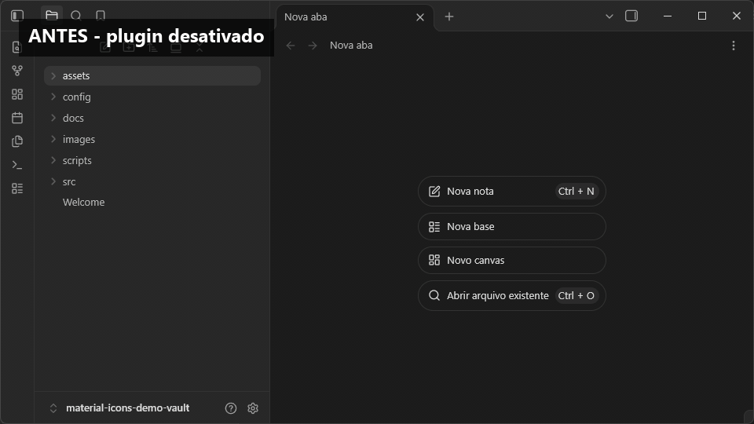

<div align="center">

# 🎨 Material Icons for Obsidian

**Ícones coloridos no estilo Material Theme para arquivos e pastas do Obsidian.**

[](https://github.com/Gust4v0Di4sC/Material-Icons-Obsidian/releases)
[](https://obsidian.md/)
[](https://github.com/Gust4v0Di4sC/Material-Icons-Obsidian/actions/workflows/ci.yml)
[](LICENSE)

[Instalação](#-instalação) · [Ícones suportados](#-ícones-suportados) · [Desenvolvimento](#-desenvolvimento) · [Reportar problema](https://github.com/Gust4v0Di4sC/Material-Icons-Obsidian/issues)



</div>

## Sobre

**Material Icons for Obsidian** personaliza o explorador de arquivos com ícones inspirados no Material Theme do VS Code. O plugin identifica extensões e nomes de pastas, aplica cores distintas e acompanha alterações no vault sem exigir atualização manual.

## ✨ Funcionalidades

- **Reconhecimento automático** — identifica arquivos pela extensão e pastas pelo nome.
- **Ícones coloridos** — diferencia rapidamente o conteúdo no explorador.
- **Atualização em tempo real** — reage à criação, exclusão e renomeação de itens.
- **Expansão preservada** — pastas continuam abrindo e fechando pelo ícone nativo.
- **Fallback inteligente** — mostra um ícone genérico para itens não mapeados.
- **Privacidade** — funciona localmente, sem enviar dados do vault ou carregar recursos externos.

## 🧩 Ícones suportados

### Arquivos

| Tipo | Extensões | Cor predominante |
|---|---|---|
| Markdown | `.md` | Roxo |
| JavaScript | `.js` | Amarelo |
| TypeScript | `.ts` | Azul |
| Python | `.py` | Azul e amarelo |
| JSON | `.json` | Amarelo |
| Estilos | `.css` | Azul |
| HTML | `.html` | Laranja |
| XML | `.xml` | Laranja |
| Configuração YAML | `.yaml`, `.yml` | Vermelho |
| Shell script | `.sh` | Verde |
| Texto | `.txt` | Cinza |
| PDF | `.pdf` | Vermelho |
| Variáveis de ambiente | `.env` | Vermelho |
| Arquivo compactado | `.zip` | Laranja |
| Imagem | `.png`, `.jpg`, `.jpeg`, `.gif`, `.webp`, `.svg`, `.ico` | Variada |
| Outros arquivos | Demais extensões | Cinza |

### Pastas

| Categoria | Nomes reconhecidos |
|---|---|
| Código-fonte | `src`, `source` |
| Recursos | `assets`, `asset` |
| Imagens | `images`, `image`, `img` |
| Documentação | `docs`, `documents` |
| Notas | `notes`, `note` |
| Projetos | `projects`, `project` |
| Templates | `templates`, `template` |
| Scripts | `scripts`, `script` |
| Configurações | `config`, `configs`, `settings` |
| Arquivos históricos | `archive`, `archives` |
| Git | `.git`, `git` |
| Outras pastas | Demais nomes |

## 🚀 Instalação

### Diretório oficial (recomendado)

1. No Obsidian, abra **Configurações → Plugins da comunidade → Explorar**.
2. Procure por **Material Icons**.
3. Selecione **Instalar** e depois **Ativar**.

[Abrir Material Icons no Obsidian](obsidian://show-plugin?id=material-icons) · [Ver no diretório oficial](https://obsidian.md/plugins?id=material-icons)

### Instalação manual

1. Baixe `main.js`, `manifest.json` e `styles.css` na [release mais recente](https://github.com/Gust4v0Di4sC/Material-Icons-Obsidian/releases/latest).
2. Crie `SEU_VAULT/.obsidian/plugins/material-icons/`.
3. Copie os três arquivos para essa pasta.
4. Recarregue os plugins e ative **Material Icons**.

## 💻 Desenvolvimento

Requer Node.js 20 ou superior e npm.

```bash
git clone https://github.com/Gust4v0Di4sC/Material-Icons-Obsidian.git
cd Material-Icons-Obsidian
npm ci
npm run lint
npm run build
```

`npm run dev` recompila durante o desenvolvimento. O build gera `main.js` localmente; esse arquivo não é versionado e é publicado somente como artefato de release.

## Arquitetura

O plugin mantém SVGs e mapeamentos em `main.ts`. Ao carregar, percorre o explorador de arquivos, reutiliza o contêiner de ícone nativo de cada item e insere o SVG correspondente. Um `MutationObserver` acompanha alterações na árvore. Ao desativar, observers, timers, classes e SVGs injetados são removidos.

## Contribuindo

Consulte [CONTRIBUTING.md](CONTRIBUTING.md). Problemas de uso podem ser enviados pelo [formulário de bug](https://github.com/Gust4v0Di4sC/Material-Icons-Obsidian/issues/new?template=bug_report.yml), e vulnerabilidades devem seguir a [política de segurança](SECURITY.md).

Os ícones foram inspirados no projeto open source [Material Icon Theme](https://github.com/PKief/vscode-material-icon-theme), distribuído sob a licença MIT.

## Licença

Distribuído sob a licença MIT. Consulte [LICENSE](LICENSE).
